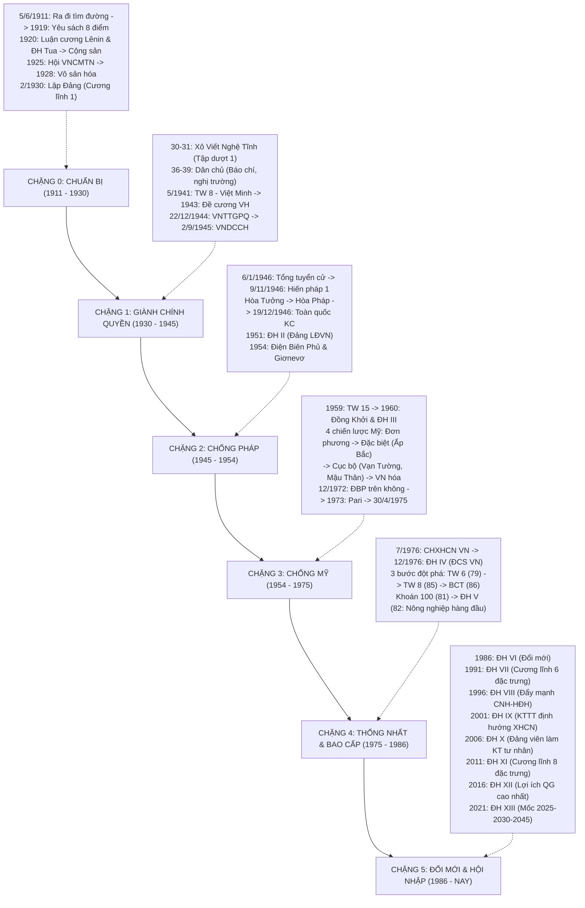
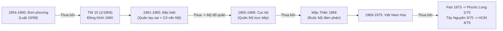

# HỆ THỐNG GHI NHỚ SIÊU TỐC: LỊCH SỬ ĐẢNG CỘNG SẢN VIỆT NAM

> **Nguyên tắc học 3 tầng:** **Tầng 1** nhìn sơ đồ nhớ khung thời gian → **Tầng 2** học cụm từ khóa độc quyền (1 Đại hội = 1 ý chính) → **Tầng 3** thuộc bộ "Thấy từ khóa → Khoanh đáp án" & "Cặp dễ nhầm".

---

## TẦNG 1: SƠ ĐỒ MẠCH LỊCH SỬ TOÀN KHÓA (1911 → 2021)

---

## TẦNG 2: CÔNG THỨC NHỚ 13 KỲ ĐẠI HỘI (MỖI ĐẠI HỘI = 1 TỪ KHÓA ĐỘC QUYỀN)

Chia 13 Đại hội thành **3 cụm** cho dễ thuộc:

### Cụm A: Chiến tranh & Thống nhất (ĐH I → ĐH V)
> **Mẹo nhớ chuỗi:** **Phục hồi (I)** → **Kháng chiến (II)** → **Hai miền (III)** → **Cả nước (IV)** → **Nông nghiệp (V)**

| ĐH | Năm | Từ khóa ĐỘC QUYỀN (nhớ là ăn điểm) | Tên Đảng / Tổng Bí thư |
| :-: | :-: | :--- | :--- |
| **I** | 1935 | **Phục hồi tổ chức** (họp ở Ma Cao) | ĐCS Đông Dương — **Lê Hồng Phong** |
| **II** | 1951 | **"Kháng chiến thắng lợi"** (Tuyên Quang); **Chính cương ĐLĐVN** (3 giai đoạn lên CNXH) | **Đảng Lao động VN** — **Trường Chinh** |
| **III** | 1960 | **2 chiến lược ở 2 miền** (Bắc: quyết định nhất; Nam: quyết định trực tiếp); KH 5 năm lần 1 | Đảng Lao động VN *(Hà Nội)* |
| **IV** | 1976 | **Cả nước quá độ CNXH**; 3 cuộc CM (KHKT then chốt); *hạn chế: chủ quan 20 năm* | **Đảng Cộng sản VN** |
| **V** | 1982 | **Nông nghiệp là mặt trận hàng đầu**; 2 nhiệm vụ chiến lược (Xây dựng + Bảo vệ) | ĐCS VN — **Lê Duẩn** |

### Cụm B: Đổi mới & Định hình mô hình (ĐH VI → ĐH IX)
> **Mẹo nhớ chuỗi:** **Mở cửa Đổi mới (VI)** → **Cương lĩnh 6 + Bạn (VII)** → **Đẩy mạnh CNH (VIII)** → **KTTT + Đối tác (IX)**

| ĐH | Năm | Từ khóa ĐỘC QUYỀN | Câu đối ngoại / Cương lĩnh |
| :-: | :-: | :--- | :--- |
| **VI** | 1986 | **Đổi mới** (TBT **Nguyễn Văn Linh**; xóa bao cấp, KT nhiều thành phần, **3 chương trình KT lớn**, **"lấy dân làm gốc"**) | Cơ chế TT 86–91 *chưa đầy đủ*; Khoán 10 (4/1988) |
| **VII** | 1991 | Lần đầu nêu **Tư tưởng HCM**; văn hóa *tiên tiến, đậm đà bản sắc* | **Cương lĩnh 1991 (6 đặc trưng)**; *"muốn là bạn"* |
| **VIII** | 1996 | **Đẩy mạnh CNH, HĐH** (KH&CN là động lực); tổng kết 10 năm đổi mới | Công bằng XH *trong từng bước* |
| **IX** | 2001 | Chính thức nêu **KTTT định hướng XHCN** | *"sẵn sàng là bạn, đối tác tin cậy"* |

### Cụm C: Hội nhập sâu & Khát vọng 2045 (ĐH X → ĐH XIII)
> **Mẹo nhớ chuỗi:** **Tư nhân (X)** → **Cương lĩnh 8 (XI)** → **Lợi ích QG (XII)** → **Cơ đồ & 3 mốc (XIII)**

| ĐH | Năm | Từ khóa ĐỘC QUYỀN | Ghi chú hay hỏi |
| :-: | :-: | :--- | :--- |
| **X** | 2006 | **Đảng viên làm kinh tế tư nhân**; CNH gắn **kinh tế tri thức** | Xây dựng Đảng = *then chốt hàng đầu* |
| **XI** | 2011 | **Cương lĩnh 2011 (8 đặc trưng)**; mục tiêu *giữa thế kỷ XXI* | Phát triển **nhanh gắn bền vững**, nhân lực chất lượng cao |
| **XII** | 2016 | Khẩu hiệu *"Đoàn kết - Dân chủ - Kỷ cương - Đổi mới"* | Lần đầu nêu **"Lợi ích quốc gia, dân tộc là mục tiêu cao nhất"** |
| **XIII** | 2021 | *"Chưa bao giờ có **cơ đồ, tiềm lực, vị thế, uy tín** như ngày nay"* | **3 mốc:** 2025 (vượt TB thấp) → 2030 (TB cao) → 2045 (Thu nhập cao); thêm **dân giám sát, dân thụ hưởng** |

---

## TẦNG 3: 6 BẢNG "PHÂN BIỆT 5 GIÂY" CHO CÁC CẶP DỄ NHẦM

### 1. Cương lĩnh 2/1930 vs Luận cương 10/1930
- **Cương lĩnh 2/1930 (Nguyễn Ái Quốc):** **Dân tộc lên hàng đầu** (chống Đế quốc trước) + **Rộng** (lôi kéo tiểu tư sản, trí thức, trung nông, phú nông, địa chủ nhỏ).
- **Luận cương 10/1930 (Trần Phú):** **Giai cấp nặng hơn** (chống Phong kiến & Đế quốc, *hạn chế lớn nhất: không đặt GPDT lên hàng đầu*) + **Hẹp** (chỉ Công – Nông).
- **Giống nhau:** Đều khẳng định vai trò lãnh đạo của **Đảng Cộng sản** (giai cấp công nhân).

### 2. Ba cao trào 1930–1945 (Nhớ theo Kẻ thù – Hình thức – Mặt trận)
- **1930–1931:** Kẻ thù *Đế quốc + Phong kiến* → **Biểu tình có vũ trang tự vệ** → *Hội phản đế ĐD* (Tập dượt 1).
- **1936–1939:** Kẻ thù *Phản động thuộc địa, phát xít* → **Báo chí & Nghị trường** (đòi *tự do, dân chủ, cơm áo, hòa bình*) → *Mặt trận Dân chủ ĐD (1938)*.
- **1939–1945:** Kẻ thù *Pháp – Nhật* → **Vũ trang, khởi nghĩa** (TW 8 tháng 5/1941 **tạm gác ruộng đất**, đặt GPDT lên hàng đầu) → **Mặt trận Việt Minh**.

### 3. Đối sách sau CMT8 (Nhớ theo 2 giai đoạn đổi chiều)
- **9/1945 → trước 3/1946:** **Hòa Tưởng – Đánh Pháp** (*Hoa Việt thân thiện*, tiêu tiền TQ, cung cấp lương thực).
- **Sau 28/2/1946 (Hiệp ước Trùng Khánh) → 19/12/1946:** **Hòa Pháp – Đuổi Tưởng** (*"Hòa để tiến"*: Hiệp định Sơ bộ **6/3/1946** + Tạm ước **14/9/1946**).

### 4. Bốn chiến lược chiến tranh của Mỹ (1954–1975)

### 5. Gom nhóm các Nghị quyết Trung ương khóa VIII–XII (Học theo 4 chủ đề thay vì học vẹt)
- **Nhóm 1 — Kinh tế & Tài nguyên:**
  - *TW 5 khóa IX (2002):* Kinh tế tập thể + **Kinh tế tư nhân**.
  - *TW 7 khóa IX (2003):* **Đất đai** là tài nguyên vô cùng quý giá.
  - *TW 5 khóa XII (5/2017):* Hoàn thiện thể chế **KTTT định hướng XHCN**.
  - *TW 8 khóa XII — NQ 36 (22/10/2018):* Chiến lược **kinh tế biển** đến 2030, tầm nhìn 2045.
- **Nhóm 2 — Giáo dục, Văn hóa, Y tế, An sinh:**
  - *TW 2 khóa VIII (12/1996):* **GD&ĐT, KH&CN** là *quốc sách hàng đầu*.
  - *TW 5 khóa VIII (7/1998):* Nền **văn hóa Việt Nam tiên tiến, đậm đà bản sắc dân tộc**.
  - *TW 6 khóa XII — NQ 20 (10/2017):* Chăm sóc **sức khỏe nhân dân**.
  - *TW 7 khóa XII — NQ 28 (5/2018):* Cải cách **bảo hiểm xã hội**.
- **Nhóm 3 — Xây dựng Đảng & Cán bộ:**
  - *TW 3 khóa VIII (6/1997):* Xây dựng **đội ngũ cán bộ** & quyền làm chủ.
  - *TW 4 khóa VIII (12/1997):* Bầu **Lê Khả Phiêu** làm TBT.
  - *TW 3 khóa X — NQ 04 (8/2006):* **Phòng, chống tham nhũng**, lãng phí.
  - *Chỉ thị 03 khóa X (11/2006):* Học tập, làm theo **tấm gương đạo đức HCM**.
  - *TW 5 khóa X — NQ 14 (7/2007):* **Kiểm tra, giám sát** của Đảng.
- **Nhóm 4 — Quốc phòng & Đối ngoại:**
  - *TW 8 khóa IX (7/2003):* **Chiến lược bảo vệ Tổ quốc** trong tình hình mới.
  - *NQ 36 khóa IX (26/3/2004):* Công tác **người Việt Nam ở nước ngoài**.

### 6. Chuỗi mốc Hội nhập quốc tế (Nhớ theo thứ tự năm tăng dần)
> **1991** (Pari về Campuchia `23/10` + Bình thường hóa TQ `10/11`) → **2/1994** (Mỹ bỏ cấm vận) → **11/7/1995** (Bình thường hóa **Việt–Mỹ**) & **7/1995** (`ASEAN`) → **1998** (`APEC`) → **1999** (`16 chữ vàng VN–TQ`) → **11/1/2007** (`WTO`, thành viên **150**) → **2012** (**36 nước** công nhận KTTT).

### 7. Kết luận Giáo trình (Nhớ gọn 4–5)
- **4 thắng lợi vĩ đại:** (1) CMT8 1945 → (2) Hai cuộc kháng chiến 1945–1975 → (3) Công cuộc Đổi mới từ 1986 → (4) Xây dựng, chỉnh đốn Đảng & nâng cao vị thế quốc tế.
- **5 bài học lớn:** (1) Độc lập dân tộc gắn với CNXH → (2) Lấy dân làm gốc → (3) Đoàn kết → (4) Sức mạnh dân tộc + thời đại → (5) Sự lãnh đạo đúng đắn của Đảng là nhân tố hàng đầu.

---

## TẦNG 4: BẢNG PHẢN XẠ "THẤY TỪ KHÓA → KHOANH ĐÁP ÁN" (1 GIÂY)

| Khi đề hỏi thấy từ khóa... | Khoanh ngay đáp án... |
| :--- | :--- |
| *"Quả trứng nở ra con chim non Cộng sản"* | **Hội Việt Nam Cách mạng Thanh niên** (6/1925, Quảng Châu) |
| *"Bước ngoặt vô cùng quan trọng" / "giai cấp vô sản trưởng thành"* | **Đảng Cộng sản Việt Nam ra đời** (2/1930) |
| **Tổ chức cộng sản đầu tiên** / **Không dự Hội nghị hợp nhất** | Đầu tiên: **Đông Dương CS Đảng** / Không dự: **Đông Dương CS Liên đoàn** |
| **Báo Le Paria** vs **Hội VNCMTN** | Le Paria = chuẩn bị **tư tưởng** / Hội VNCMTN = chuẩn bị **tổ chức** |
| **Căn cứ địa đầu tiên (39–45)** vs **Căn cứ chống Pháp** | 39–45: **Bắc Sơn – Võ Nhai** / Chống Pháp: **Việt Bắc** |
| **Tự giải tán 11/11/1945** | **Hội nghiên cứu Chủ nghĩa Mác ở Đông Dương** |
| **Khẩu hiệu "Dân tộc trên hết, Tổ quốc trên hết"** | Chỉ thị **Kháng chiến kiến quốc (25/11/1945)** |
| **>90% mù chữ** / **Chi viện Nam Bộ (23/9/1945)** | **Bình dân học vụ** / Phong trào **Nam tiến** |
| **Đánh bại "đánh nhanh thắng nhanh"** | Chiến dịch **Việt Bắc Thu - Đông 1947** |
| **Phá sản kế hoạch Nava** / **"Bạch Đằng, Chi Lăng, Đống Đa TK XX"** | Chiến dịch **Điện Biên Phủ 1954** (3 đợt, *Đánh chắc tiến chắc*) |
| **Điểm giống Hiệp định Giơnevơ (1954) & Pari (1973)** | Đều cam kết tôn trọng **4 quyền dân tộc cơ bản** (độc lập, chủ quyền, thống nhất, toàn vẹn lãnh thổ) |
| **Mở đường cho Đồng Khởi 1960** | **HNTW 15 khóa II (1/1959)** *(chuyển từ giữ gìn sang tiến công)* |
| **Mặt trận DTGPMNVN** | Lập ở **Tây Ninh**, Chủ tịch **Nguyễn Hữu Thọ** |
| **Khẩu hiệu "Tất cả để đánh thắng giặc Mỹ xâm lược"** | **HNTW 11 (3/1965) & HNTW 12 (12/1965)** |
| **"Đòn thăm dò chiến lược"** / **Mở màn Xuân 1975** / **Tư lệnh HCM** | **Phước Long (1/1975)** / **Tây Nguyên (3/1975)** / **Văn Tiến Dũng** |
| **Điểm mới chống Mỹ so với chống Pháp** | Kết hợp **khởi nghĩa từng phần** với chiến tranh cách mạng |
| **Hiệp thương thống nhất (11/1975)** / **Tên nước CHXHCN VN** | Họp tại **Sài Gòn** (Phạm Hùng) / **Tháng 7/1976** (Chủ tịch Tôn Đức Thắng) |
| **Bước đột phá đầu tiên / thứ 2 / thứ 3 về đổi mới KT** | **TW 6 (8/1979)** → **TW 8 khóa V (6/1985: giá-lương-tiền)** → **Bộ Chính trị (8/1986)** |
| **Khoán 100** vs **Khoán 10** | **Chỉ thị 100 (1/1981)** (nhóm/người LĐ) vs **NQ 10 (4/1988)** (hộ nông dân tự chủ) |
| **Đề cương văn hóa VN (1943)** / **Đội VNTTGPQ** | **Dân tộc – Khoa học – Đại chúng** / **22/12/1944** (Võ Nguyên Giáp) |
| **Tổng tuyển cử đầu tiên** / **Hiến pháp đầu tiên** | **6/1/1946** / **9/11/1946** |
| **Điện Biên Phủ trên không** / **HNTW 21 khóa III (7/1973)** | **18–29/12/1972** (buộc ký Pari) / Tiếp tục **bạo lực cách mạng** ở miền Nam |
| **Vai trò KT Nhà nước** / **Đảng** / **MTTQ** | KTNN: **chủ đạo** / Đảng: **trụ cột** / MTTQ: **đại diện quyền lợi nhân dân** |
| **Yếu tố quyết định tăng trưởng** / **Động lực phát triển** | **Con người** / **Đại đoàn kết toàn dân** (công - nông - trí thức) |
| **Nội dung chủ yếu của đấu tranh giai cấp hiện nay** | Thực hiện thắng lợi sự nghiệp **CNH, HĐH theo định hướng XHCN** |
